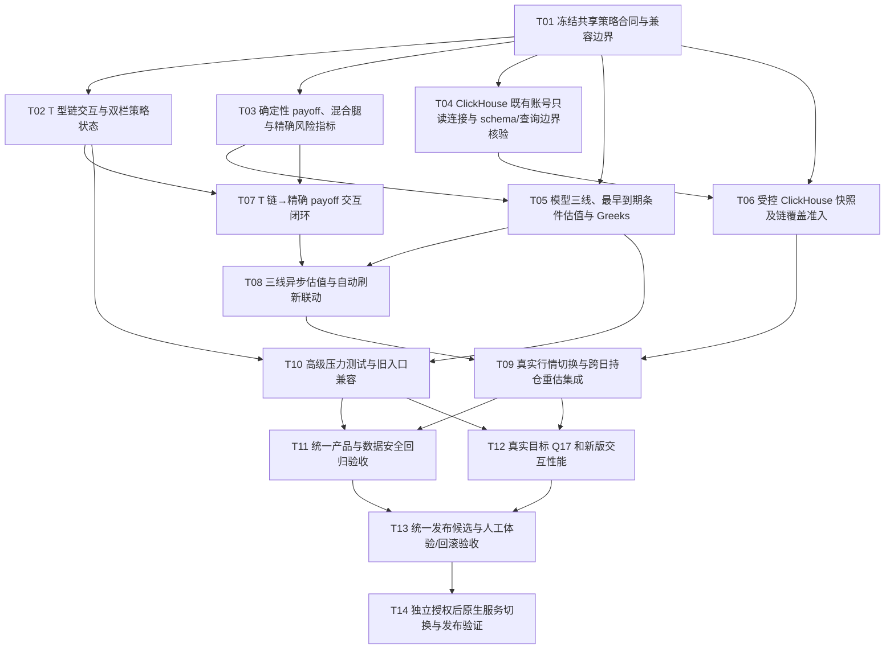

# M1-D12 并行实施任务 DAG

状态：修订版实施 DAG（运行进度以原 D12 Goal 为准，T04 in_progress；已完成步骤不重做）。Source of truth: m1-d12-strategy-builder-spec.md、ADR、tickets.json。仅本地文档，无远程 issue。

> **2026-11-25 11:25 UTC / 北京时间19:25 — 用户确认只读消费者边界（当前有效，优先于此前 T04/A1/SQLite-first 文件中冲突的 ClickHouse 前置门禁）。** 复用已提供的既有 ClickHouse 目标与 quant 账号；用户确认账号权限足够。OptionMaster 只查询数据库内已存在的行情，不要求 QuantFeed 停写、全局 Writer/锁/INSERT/未决发布/待写入检查、生产者 manifest 或专用代理/角色/opaque Reader 回执作为读取前置条件。旧 CP68/A1/SQLite 证据保留为历史，不再作为 D12 读取阻塞。Reader 绑定仅指服务端既有目标+账号的安全凭证引用与实际 SELECT 可用；无需新建账号、改权限、专用角色或读取/披露密码。使用固定参数 SELECT、已授权表/列/键、分页及请求/扫描/超时/结果限制；优先查询级保护，不改持久 profile/settings；不得把 LIMIT 或客户端超时单独当作扫描上限。无法安全限制的查询应收窄或拒绝。账号权限由用户确认，连通性/schema/实际 SELECT 尚待 T04 验证，本文件不冒充运行证据。既有数据读取不需要逐日生产者静止证明；仅在数据完整性可证时称 latest complete，其他可见数据明确 PARTIAL/COVERAGE_UNKNOWN，缺失/冲突的选中腿不可估值。既有精确历史 pin 不改，保留 terms/mark/basis、Q16 消费者快照验证、Q17 实测预算、全量回归及独立发布授权。禁止任何生产写入、GM/API新采集、权限/服务修改、Git发布或实盘操作。本次仅修订文档与Goal，未执行数据库请求。

**T04 实施记录（2026-11-25 11:32 UTC）：** `quant` 账号权限为用户确认，未实测。既有 LAN 目标上的 `optionmaster_history` 是此前已获授权且已配置的只读账号，本次通过安全凭证引用认证、实际资源限制、表结构及代表性 EXPLAIN 核验；可复用这一现有通道，不要求专用账号、角色或新增绑定，也不改变 quant 可选地位。仅研究诊断，不冒充生产 TLS 或应用端连接验收。实际记录见 `docs/evidence/m1-d12/T04-consumer-read-verification-20261125.md`。

目标：Q15 C，共享合同后 UI/计算/数据分支依赖执行；T04/T06 使用既有只读目标、消费者验证，不等待 QuantFeed。T12 独立确认真实 Q17 资源预算；T14 独立发布授权。并行依赖不是 Agent/并发访问授权。SQLite-first L01–L03 已完成，原依赖边不变。

## Topological layers
- Layer 1: T01
- Layer 2: T02, T03, T04
- Layer 3: T05, T06, T07
- Layer 4: T08, T10
- Layer 5: T09
- Layer 6: T11, T12
- Layer 7: T13
- Layer 8: T14

Original DAG frontier: T01. Current Goal T01/T02/T03/T05/T07/T08/T10 and L01–L03 complete; T04 resumes on existing read-only scope, without producer-state checks. T06 and T09 depend on actual consumer-side validation. T11/T12 on same frozen integrated candidate; T12 bounded budget independently approved. Preserve scope ownership and completed work.

## Tickets

### T01 — 冻结共享策略合同与兼容边界
- blocked_by: []
- state: READY; gate: G01/G02/G03/G05
- deliverable: 版本化 v4 合同、状态/单位/域/输入版本、OpenAPI 与独立 fixtures；旧 v1-v3 保持。
- acceptance:
  - 15项决定逐条映射、明确 max leg/quantity/body/axis、价域、时间/IV、eligibility 和错误契约，未决授权门禁独立记录
  - 固定独立 payoff/model/data contract fixtures；新 schema 不改变旧 schema 或公开大网格
  - 明确每个分支接口和责任、禁止共享文件无协调修改
- verification: 契约测试、旧 OpenAPI 兼容 diff、独立 fixture review

### T02 — T 型链交互与双栏策略状态
- blocked_by: T01
- state: BLOCKED; gate: G04
- deliverable: 在真实批准 archive provider/明确测试 fixture 上实现可交互 T 链、持仓、分栏和草稿状态；不作为发布。
- acceptance:
  - 直接 +/-/输入、0 删除、跨月保留、最多8期权、标的腿编辑与每腿成本；键盘和窄屏布局
  - 月份/日期/品种切换按 Q10；旧结果清理和缺失行状态
  - 新前端只用生成合同，mock仅测试
- verification: React reducer/contract tests、Chromium fixture interaction

### T03 — 确定性 payoff、混合腿与精确风险指标
- blocked_by: T01
- state: BLOCKED; gate: G01
- deliverable: 纯领域服务和 payoff API；一至八期权与对应标的线性 P&L、解析分段与指标。
- acceptance:
  - 同期限真实 intrinsic，无有效IV仍可；entry与market reference 独立
  - 独立测试 10类策略、零/平段、多根、尾斜率无界、有限域与条件性、乘数及空头符号
  - 单一能力失败 null；缺失腿不算零；无模型/实盘改动
- verification: TDD 独立黄金值、边界性质、ASGI payoff contract tests

### T04 — ClickHouse 既有账号只读连接与 schema/查询边界核验
- blocked_by: T01
- state: READY (Goal: in_progress); gate: G03
- deliverable: 复用既有目标和已授权账号（quant 或已有且实际核验通过的只读账号）的只读连接、schema/键、固定 SELECT 查询计划及有界执行证据。
- acceptance:
  - 用户已确认既有账号权限足够；不新增账号/角色/代理、不读取凭证明文、不依赖 QuantFeed Writer/锁/INSERT/未决发布/待写入或 A1 opaque 回执
  - 实际目标及 SELECT 连通性、表/键/字段与必要 EXPLAIN；固定参数、白名单、查询级正向扫描/时间/结果限制及客户端 deadline；不得改持久权限/profile/settings
  - 读取既有行情范围；检查条款/标的配对/日历/价格口径的可用证据；完整性未知显式标记，不要求全库或生产者证明
- verification: 用户决策记录、实际 SELECT/metadata/必要 EXPLAIN、有限查询保护与结果；无生产写

### T05 — 模型三线、最早到期条件估值与 Greeks
- blocked_by: T01, T03
- state: BLOCKED; gate: G01/G02
- deliverable: 新模型 valuation API 复用 D10/D11，在同期限/跨期限/混合策略返回分能力结果。
- acceptance:
  - 当前与情景按现有模型，terminal同期限精确，最早到期 intrinsic + far leg 定价；未知 cutoff/IV fail closed
  - Sticky Strike、独立期限和交割月冲击、锁定128步、per-underlying Greeks
  - 旧 pre-expiry guard 未放宽；标的线性；模型费时有界
- verification: D11/T07 parity、日历/diagonal/失败输入 ASGI tests

### T06 — 受控 ClickHouse 快照及链覆盖准入
- blocked_by: T01, T04
- state: BLOCKED; gate: G03
- deliverable: 真实只读 provider：有界 coverage/chain/selected snapshot；在完整性可证时标记 latest complete day，保留 archive adapter。
- acceptance:
  - 仅以既有 DB 可见行情构建请求内冻结快照；核对选中 exact key/date/terms/mark/basis 与重复、冲突、缺失，跨查询记录读时和可用版本；生产者持续写入不构成门禁
  - 缺失/冲突/可检测版本变化的选中腿 unavailable；有数据可展示，覆盖不完整或未知标 PARTIAL/COVERAGE_UNKNOWN，不声称完整日/全局事务快照；仅可证完整时称 latest complete
  - 固定参数SELECT、限制/timeout/no retries；单请求一次物化，后续估值复用；旧pin不变，真实多日期/月份/品种及spot仅声明经验证范围
- verification: 负例/隔离 provider 测试+实际有界 CH SELECT/消费者 Q16 coverage ledger

### T06 当前历史研究范围（2026-11-25 用户决策）

T06 仅消费既有 ClickHouse 历史行情，不接入实时 GM/CTP/WebSocket，不采集、补录、同步行情，不连接交易或持仓。复用原 T04 已验证边界，不以 QuantFeed 状态为前置条件。收敛为四个内部交付切片，不新增 DAG 节点：
- T06-A 历史目录：显式有限 portfolio/date window，固定 SQL 与实测计划及预算，目录候选不冒充已验证报价。
- T06-B T 型报价：按已验证日期、合约身份/条款与标的读取，分批查询；缺失/冲突明确不可用。
- T06-C 历史分析快照：每次授权观察冻结已消费行、来源/版本/读时及口径；复用现有 payoff/model/Greeks，允许部分覆盖有效腿；不声称全局事务或原始日 PIT。
- T06-D 集成验收：离线 Provider/HTTP 模拟与既有 API/Archive 回归，另需已授权真实 CH 选中数据验证、跨范围 Q16 及后续 T09 UI 联动。

本轮离线实现已完成，实际 CH 新请求为零；原 12/12 额度耗尽，不自动启动连接或扩大范围。仅可在另获真实读取授权、明确范围及预算后执行真实观察。T06 仍 in_progress、G03/Q16 未通过、T09–T14 独立，生产 NO-GO。证据：docs/evidence/m1-d12/T06-historical-provider-offline-r66-20261125/REPORT.md。

### T07 — T 链→精确 payoff 交互闭环
- blocked_by: T02, T03
- state: BLOCKED; gate: G01/G04
- deliverable: 链编辑直接触发有界 payoff，主图准确拐点/平衡点与风险状态，标的腿和权利金联动。
- acceptance:
  - 实际 archive UI 至真实 payoff API；无需IV的有效腿可显示 exact terminal
  - 无界/条件/不可用/空组合、零成本和 qty/entry 更新不留陈旧结果
  - 右侧图和风险、拆分布局可操作
- verification: 真实 Chromium archive flow+数值响应断言

### T08 — 三线异步估值与自动刷新联动
- blocked_by: T05, T07
- state: BLOCKED; gate: G02/G04
- deliverable: 模型 current/scenario/horizon 叠加、IV/time/price controls、分能力异步状态。
- acceptance:
  - 严格 revision+snapshot+request generation；延迟/逆序、A-B-A、取消/超时、429 不污染
  - 轻量 payoff 优先、有界防抖；缓存只用精确有效的已核对模型输入
  - 每条线/点的时钟/单位/条件/腿贡献清晰，远月未到期依赖IV
- verification: ASGI concurrency tests+browser delayed response tests

### T09 — 真实行情切换与跨日持仓重估集成
- blocked_by: T06, T08
- state: BLOCKED; gate: G03/G04
- deliverable: 基于真实批准 ClickHouse scope 完整策略流程：最新完整日、日期/产品/月、重估与重建。
- acceptance:
  - 同一快照、保留 entry、最早到期限制，未准入新数据或失效腿显示 unavailable
  - 无自动回退旧归档、无混日期、无权查询拒绝
  - 实际期货混合流程，spot 实际证据覆盖结论；至少明确目标真实可用范围
- verification: 实际 composed API/Chromium 真实选中数据及 lineage tests

### T10 — 高级压力测试与旧入口兼容
- blocked_by: T02, T05
- state: BLOCKED; gate: G05
- deliverable: 独立 Advanced Analysis 与旧 v1/v2/v3 入口保留；兼容组合无损投影，超范围说明。
- acceptance:
  - 旧 route/schema/semantics/caps 与历史 approved payload 未变化
  - 新 entry P&L 与旧 mark change 不混淆；单腿/混合或IV不可用不隐式丢腿
  - 保留既有 UI/证据与实盘模块不变
- verification: legacy DTO snapshots、原浏览器回归及兼容投影负例

### T11 — 统一产品与数据安全回归验收
- blocked_by: T09, T10
- state: BLOCKED; gate: G01–G05
- deliverable: 同一候选版本完成 G01–G05，真实策略矩阵、全量测试、安全/版本兼容证据。
- acceptance:
  - 全部适用 gate 有实际测试/报告、真实 Chromium desktop/mobile
  - 1199/86/13历史基线不替代本轮；ruff/mypy/uv/build/packaging/pytest 全跑并审查
  - 数据来源/资源/security、live source、旧 archive/审批和工作树保护
- verification: full regression, end-to-end tests, review diff/manifests

### T12 — 真实目标 Q17 和新版交互性能
- blocked_by: T09, T10
- state: BLOCKED; gate: G06
- deliverable: 独立受控目标测量与签署操作预算，完整 Q17 加策略流。
- acceptance:
  - 实际fresh CH read/IV/全估值/serialize/render, 冷暖配对、2/4/8与11/21/31网格诊断、实际三线/快速编辑
  - 足够重复 p50/p95/CPU/RSS/error/phase；约束真实请求/成本与扫描，未授权不跑
  - 冻结并独立批准预算再判 pass/fail；旧 HTTP cap 不变
- verification: actual benchmark evidence/approval and validation against approved envelope

### T13 — 统一发布候选与人工体验/回滚验收
- blocked_by: T11, T12
- state: BLOCKED; gate: G07
- deliverable: 完整 release candidate 私有独立端口，manifest、健康、人工体验及 rollback rehearsal；不切换旧服务。
- acceptance:
  - 全部 G01–G06 与目标范围通过；实际构建资产和依赖、可重复候选/旧版本恢复 bundle
  - auth/no-store/host/无 trade；真实候选 browser & health、明确用户验收证据
  - 最终许可和目标待明确时保持 NO-GO；无原服务改动
- verification: release manifest, private staged E2E and rollback rehearsal

### T14 — 独立授权后原生服务切换与发布验证
- blocked_by: T13
- state: BLOCKED; gate: G07
- deliverable: 仅在明确 release/restart 目标授权后一次性切换；可回滚且实证。
- acceptance:
  - 批准 exact build/target 及暴露范围、真实健康/静态/鉴权/估值/监听进程验证
  - 失败按已验收回滚恢复旧服务并复验，记录实际证据；未授权阻塞
  - 禁止 DB写/实盘/Git或网络额外操作；无 Docker
- verification: authorized cutover, real post-start smoke, rollback readiness

## Gate notes

Ticket statuses are dependency planning, not runtime evidence; current Goal is authoritative. Existing completed steps and historical evidence remain unchanged. T04 no longer depends on QuantFeed or dedicated Reader attestation; actual bounded SELECT/schema still unverified. T06 consumer Q16, T09 integration, T11–T14 regression/Q17/release remain. No database request, code implementation, Git publication or deployment performed by this revision. New release remains NO-GO.

## 2026-11-25 12:13:52 UTC — 用户授权修订（当前有效）

取消此前人为设定的 CH 累计次数限制及普通只读查询逐批审批。既有目标和已授权账号允许自主进行历史行情发现、分页、固定参数 SELECT/EXPLAIN、Q16 与现有资源范围内验收，不再以历史 12/12 流水为停止条件。原流水与历史证据保留不改。保留单请求 100000 扫描行/16 MiB、5 秒、64 MiB 内存、64 行/1 MiB 结果、throw、客户端 8 秒及串行、失败停止、不自动重试；每批仍有明确的有限计划及防重复执行记录，属于工程保护而非新增审批。禁止数据库写入、DDL、权限/profile/settings 变更、GM/CTP/实时/QuantFeed 探测、服务切换或 Git 发布。独立发布门禁及超出现有资源边界的操作保持原约束。
